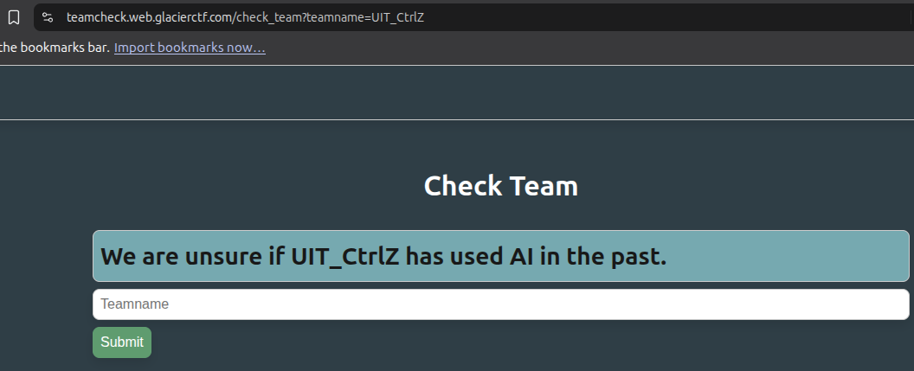
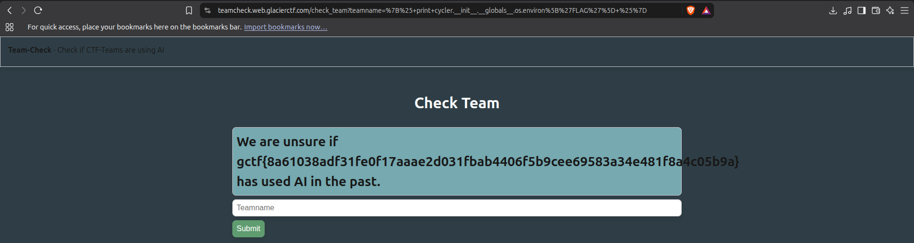

# Team-Check

## Description
Lately, a lot of teams have started to use AI. We built a small webapplication to check if people use it for CTFs.

## Analysis
Challenge cung cấp 1 website nhập tên đội và ấn nút ```Submit``` để kiểm tra đội đó có sử dụng AI không. Submit thử tên 1 đội và nhìn vào url -> Ta biết được cách server xử lí tham số ô ```Teamname```.


Trong file ```app.py```, ứng dụng định nghĩa 2 danh sách:
- AT_TEAMS: Những đội được đánh giá không sử dụng AI.
- LOSTEAMS: Những đội được đánh giá có sử dụng AI.
```python
LOSTEAMS = [
    "LosFuzzys", "S1gW0zzys", "podmanenjoyer"
]

AT_TEAMS = [
    # The OGs wouldn't do it
    "WE_0WN_Y0U", "HgbSec", "KuK Hofhackerei", "SIGFLAG", "/dev/stp",
    "OneManParty", "defragmented brains", "WeAreScientists"

    # These ones are also not known for using AI
    "sp3ng3rh4ck", "GiG Gehackt ist Geil", "inFLAGranti",
    "MeetingPostponed", "KUDDAHSEC", "Zook"
]
```

Endpoint xử lí chính là ```/checkteam```. Luồng hoạt động của ứng dụng:
1. Nhận tham số ```teamname``` từ HTTP request.
2. Kiểm tra dữ liệu đầu vào.
3. Tạo nội dung thông báo bằng Jinjia2.
4. Kiểm tra tên đội có thuộc AT_TEAMS hoặc LOSTEAMS hay không.
5. Render trang HTML và hiển thị kết quả.
```python
@app.route('/check_team')
def challenge():
    team_name = flask.request.args.get("teamname")
    if not team_name:
        return render_template('index.html')

    # Security-Checks
    if "{{" in team_name or "}}" in team_name:
        return render_template('index.html')

    team_msg = flask.render_template_string(
        f"We are unsure if {team_name} has used AI in the past."
    )
    info_color = "info"

    if team_name in AT_TEAMS:
        team_msg = f"We don't think that {team_name} has used AI in the past"
        info_color = "success"

    elif team_name in LOSTEAMS:
        team_msg = f"Yes, {team_name} has has used AI in the past!"
        info_color = "danger"

    return render_template(
        'index.html', team_msg=team_msg, info_color=info_color
    )
```

Python sẽ thay thế ```{team_name}``` bằng string nhập vào. Sau đó hàm render_template_string() biên dịch và thực thi string đó như một Jinja2 template -> Xác định được lỗi SSTI.
```python
team_msg = flask.render_template_string(
    f"We are unsure if {team_name} has used AI in the past."
)
```

Cơ chế lọc dạng cú pháp thông thường của Jinja2: ```{{ expression }}```. Tuy nhiên bộ lọc chỉ chặn một dạng cú pháp mà không chặn toàn bộ cú pháp của Jinja2.
```python
if "{{" in team_name or "}}" in team_name:
    return render_template('index.html')
```

## Idea
Trong file ```entrypoint.sh```, flag được đọc từ ```/flag.txt``` và lưu vào biến môi trường FLAG thông qua lệnh:
```python
export FLAG=$(cat /flag.txt)
```
Thay vì tìm cách đọc trực tiếp file trên hệ thống, có thể tận dụng SSTI để truy cập biến môi trường của Flask. Ứng dụng đã chặn ```{{``` và ```}}```, tuy nhiên Jinja2 hỗ trợ `````` để đánh giá và xuất kết quả của một biểu thức. Kết hợp cycler có sẵn, ta có thể truy cập Python global namespace thông qua __globals__, từ đó tiếp cận module os và các biến môi trường. Nhập payload vào ô ```Teamname``` sau đó Submit, ta có được flag.

## Payload
```jinja2

```

## Flag
```
gctf{8a61038adf31fe0f17aaae2d031fbab4406f5b9cee69583a34e481f8a4c05b9a}
```

